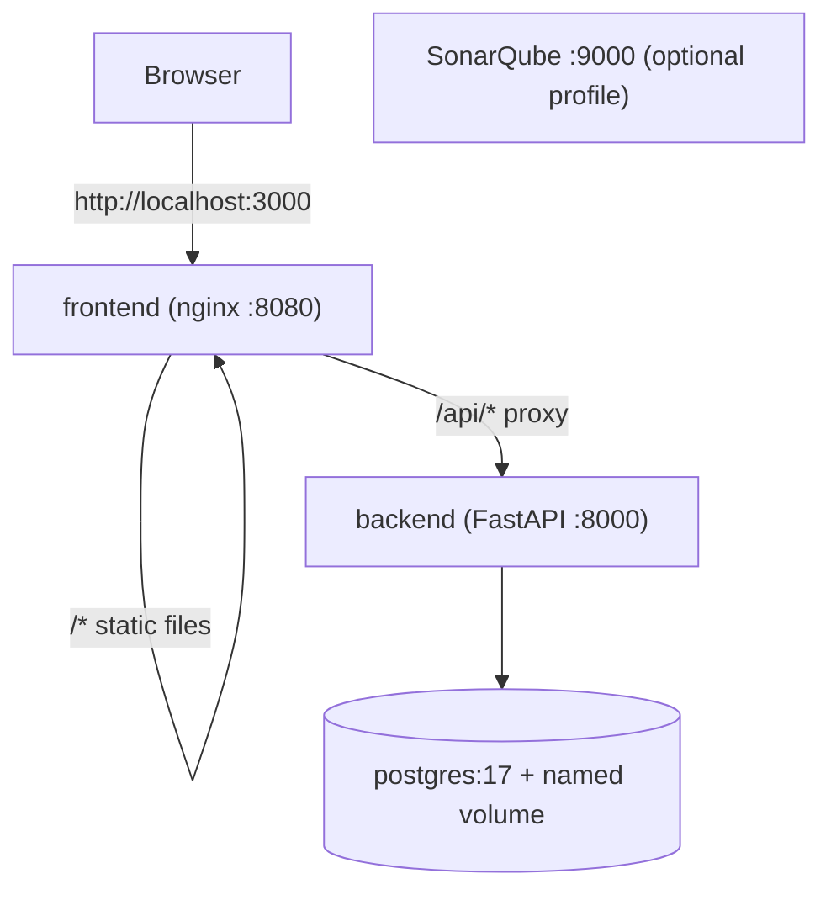

TaskBoard is a task manager made of a **Next.js** frontend, a **Python FastAPI** backend and a **PostgreSQL** database. This repository contains the DevOps work around it: containers, local orchestration, security scanning, and (in later phases) Helm, Kubernetes, Terraform, GitHub Actions and Argo CD.

## Architecture (local)

Locally, **nginx plays the role CloudFront will play in AWS**: it serves the static frontend and forwards `/api/*` to the backend, so the browser only ever talks to one origin (no CORS).



| Service | Image | Port | Notes |
|---|---|---|---|
| `db` | `postgres:17-alpine` | internal 5432 | named volume `pgdata`, `pg_isready` healthcheck |
| `backend` | built from `app/backend` | 8000 | starts after `db` is healthy, healthcheck on `/api/health/ready` |
| `frontend` | built from `app/frontend` | 3000 to 8080 | starts after `backend` is healthy |
| `sonarqube` | `sonarqube:community` | 9000 | only with `--profile sonar` |

## Repository layout

```
.
├── app/
│   ├── backend/            # FastAPI app + Dockerfile + .dockerignore
│   └── frontend/           # Next.js app + Dockerfile + nginx.conf.template
├── local-setup/
│   ├── docker-compose.yml
│   └── README.md           # short how-to for the Compose stack
├── deploy/helm/taskboard/  # (phase A4) Helm chart
├── infra/                  # (part B) Terraform
├── gitops/                 # (part B) Argo CD applications
└── .github/                # (part B) workflows and composite actions
```

## Prerequisites

- Git
- Docker Engine or Docker Desktop with the Compose plugin (`docker compose version`)
- A free port 3000, 8000 (and 9000 for SonarQube)
- Linux only, for SonarQube: `sudo sysctl -w vm.max_map_count=262144`

## Run locally with Docker Compose

```bash
cd local-setup
docker compose up --build -d
docker compose ps                    # wait until db, backend, frontend are "healthy"
```

Then open:

| What | URL |
|---|---|
| Application | http://localhost:3000 |
| API docs | http://localhost:8000/api/docs |
| Liveness | http://localhost:3000/api/health |
| Readiness | http://localhost:8000/api/health/ready |
| Metrics | http://localhost:8000/metrics |

**Persistence check.** Tasks must survive both of these:

```bash
docker compose restart backend
docker compose down && docker compose up -d      # without -v
```

**Stop.**

```bash
docker compose down        # keeps the database volume
docker compose down -v     # also deletes the data
```

**Logs.** `docker compose logs -f backend`

**Optional SonarQube.**

```bash
docker compose --profile sonar up -d             # http://localhost:9000 (admin / admin on first login)
```

## Container images

### Backend (`app/backend/Dockerfile`)

- Official slim, pinned base image: `python:3.13-slim`.
- `requirements.txt` is copied and installed **before** the code, so dependency layers are cached.
- `pip` (and setuptools/wheel) are uninstalled after installing dependencies, so the runtime image has no package manager.
- Runs as a **non-root numeric user** (`USER 10001`), which lets Kubernetes enforce `runAsNonRoot`.
- `APP_VERSION` can be set at build time (`ARG` to `ENV`).
- `.dockerignore` keeps tests, caches and virtual environments out of the image.

### Frontend (`app/frontend/Dockerfile`, local use only)

- **Multi-stage build.** Stage 1 (`node:22-alpine`) runs `npm ci` and `npm run build` to produce the static site in `out/`. Stage 2 (unprivileged nginx on Alpine) serves it.
- nginx forwards `/api/` to the backend. The address comes from the `BACKEND_URL` environment variable through nginx's `templates/` + `envsubst` feature.
- Runs as non-root (`USER 101`) and listens on port **8080**.
- The final stage runs `apk upgrade` so OS packages carry the latest security patches.
- In AWS this image is not used: the same `out/` folder is uploaded to S3 and served by CloudFront.

## Security scans (shift left)

Every scanner planned for the CI pipelines is first run locally with a pinned Docker image, from the repository root.

| Scanner | Finds | Command |
|---|---|---|
| Gitleaks | Secrets | `docker run --rm -v "$PWD:/src" ghcr.io/gitleaks/gitleaks:v8.30.1 dir /src --redact` |
| TruffleHog | Secrets | `docker run --rm -v "$PWD:/src" trufflesecurity/trufflehog:3.99.2 filesystem /src` |
| Trivy (files) | Vulnerable dependencies, secrets, misconfigurations | `docker run --rm -v "$PWD:/src" aquasec/trivy:0.75.0 fs /src --scanners vuln,secret,misconfig --severity HIGH,CRITICAL` |
| Trivy (image) | Vulnerable OS packages and libraries | `docker run --rm -v /var/run/docker.sock:/var/run/docker.sock aquasec/trivy:0.75.0 image <image> --severity HIGH,CRITICAL --ignore-unfixed` |
| SonarQube | Bugs, code smells, coverage, quality gate | see below |

Before scanning, remove generated folders (`node_modules`, `.next`, `out`, `.venv`) so results only cover real source. Build images with `docker build --pull` so an old cached base image does not report already-fixed vulnerabilities.


### Results

Fill in after your final scan run.

| Scan | Result |
|---|---|
| Gitleaks | _no leaks found / describe_ |
| TruffleHog | _no verified secrets / describe_ |
| Trivy files | _0 HIGH/CRITICAL / describe_ |
| Trivy image: backend | _0 HIGH/CRITICAL_ |
| Trivy image: frontend | _0 HIGH/CRITICAL_ |
| SonarQube quality gate (backend) | _Passed_ |


